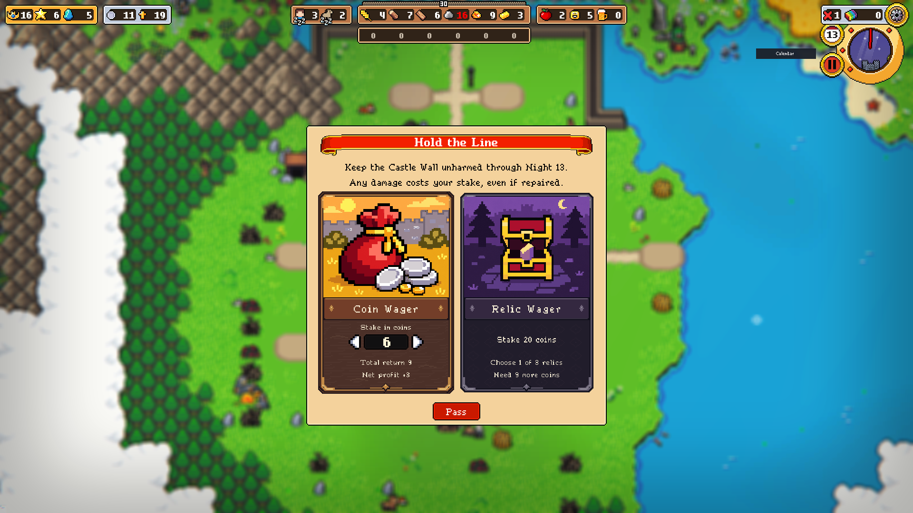
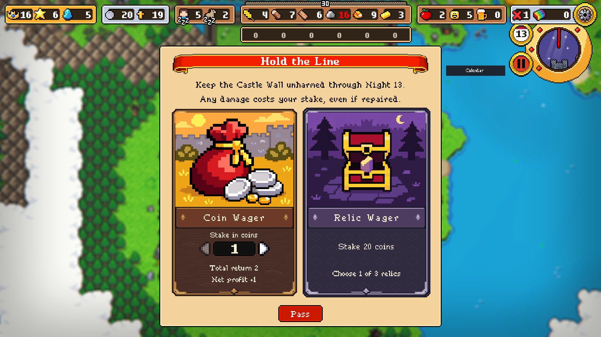
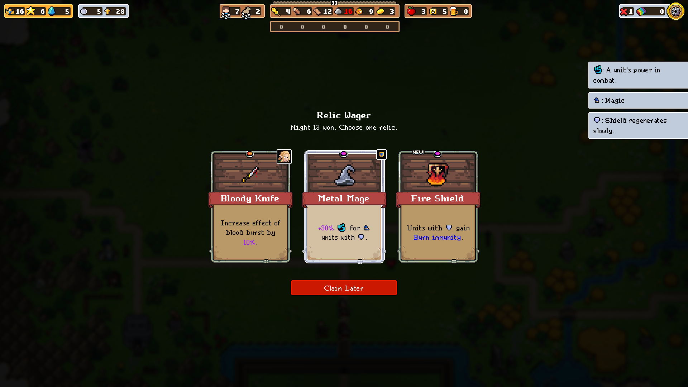
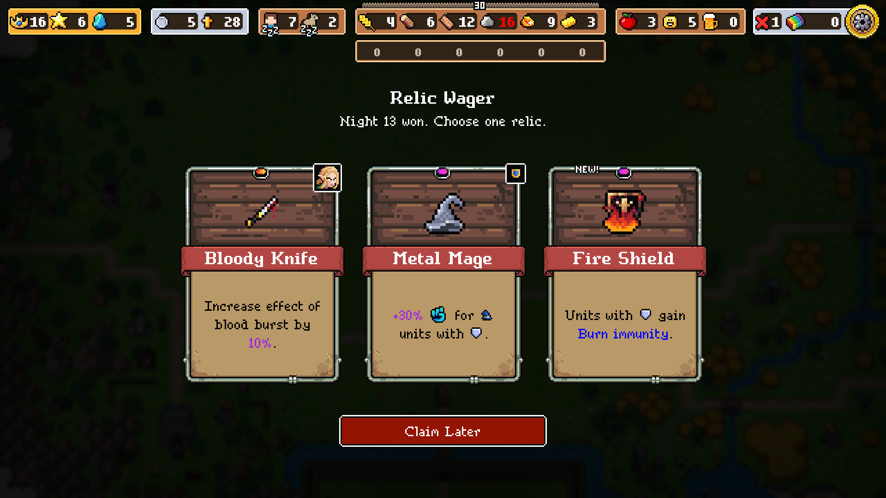

# Hold the Line

Before battle, choose a coin wager, stake 20 coins for a relic, or pass. To win, keep your Castle Wall unharmed through the entire night.

## Features

- One free decision each eligible night. **Pass** starts focused.
- Choose a target coin profit. The offer shows the stake, the total returned on a win, and the net profit before you commit.
- A **Relic Wager** costs exactly 20 coins. A win earns one of three distinct eligible ordinary relics. The offer needs three candidates before it can take your stake.
- Losing wall health forfeits either wager, even after a full repair. A fully shielded hit keeps the wager alive.
- The native checkpoint carries the accepted terms and any unclaimed rewards. Wagers accepted on 0.1.5 keep their original one-coin stake and three-coin return.

## How to Use

1. With a standing Castle Wall, wait for the prebattle offer. Use the arrows on the **Coin Wager** card to adjust the stake. The black counter shows how many coins you will pay. For example, a profit of 3 costs 6 coins and returns 9 total on a win.
2. Choose **Coin Wager** or **Relic Wager** to pay the displayed stake. Choose **Pass** or press **Back** to keep your coins.
3. Defend the wall until the night ends. After a relic win, choose a card or select **Claim Later** to see those same choices on another morning or after Continue.

## Screenshots

**Coin Wager at 1×**

**Relic Wager at 1.5×**

**Relic picker at 1×**

**Relic picker at 1.5×**

## Compatibility

Tested on Super Fantasy Kingdom **0.8.068** at 1× and 1.5× UI scale with mouse, keyboard, and virtual controller input. The wager works alongside the [Daybook resource HUD](https://thunderstore.io/c/super-fantasy-kingdom/p/GKJ/Daybook/) and [Visitor Calendar](https://thunderstore.io/c/super-fantasy-kingdom/p/GKJ/VisitorCalendar/).

When playing with Nights of Terror, the wager settles after the final reinforcement is defeated.

## Installation

1. Open a Super Fantasy Kingdom profile in Thunderstore Mod Manager and install **HoldTheLine** by **GKJ**. Allow the manager to install [BepInExPack](https://thunderstore.io/c/super-fantasy-kingdom/p/BepInEx/BepInExPack/) and [HideManagerGameObject_Config](https://thunderstore.io/c/super-fantasy-kingdom/p/BepInEx/HideManagerGameObject_Config/).
2. Select **Start modded** and load your kingdom. Once you have a standing Castle Wall, watch for the offer before battle.

## Support

[Support GKJ Games on Ko-fi](https://ko-fi.com/gkj_games)
