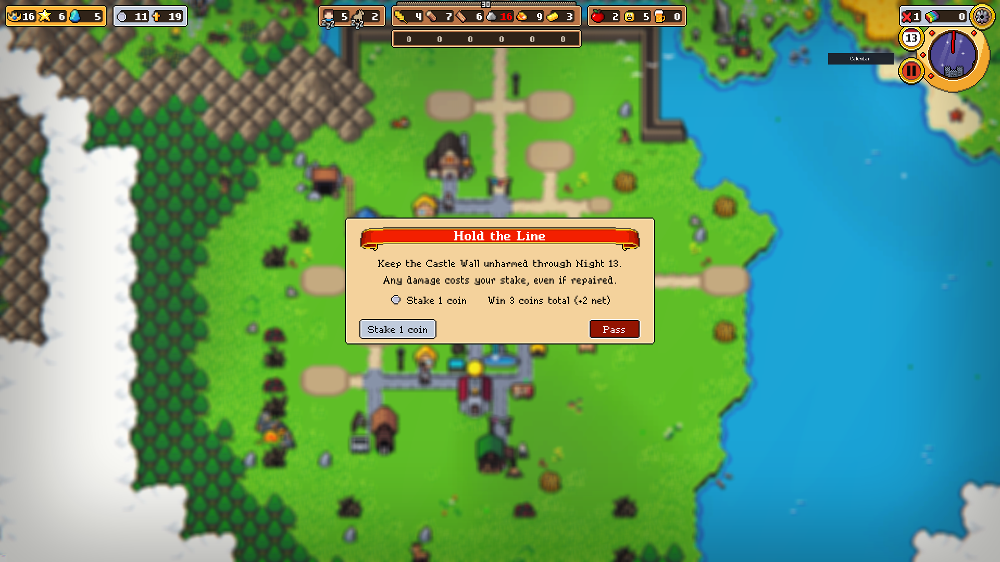
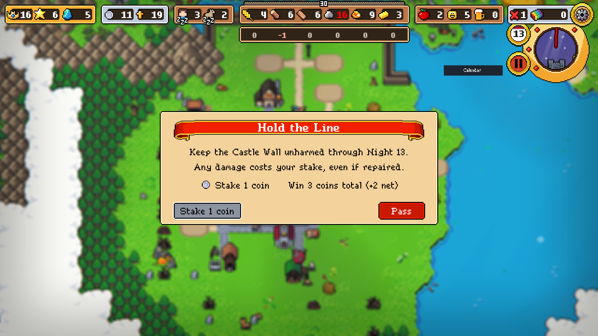

# Hold the Line

Stake one coin on your Castle Wall surviving the night unharmed. A clean night pays **3 coins total**, including the stake, for a **net gain of 2 coins**.

## Features

- One voluntary wager per eligible day when your kingdom has a standing Castle Wall.
- The offer shows the price, payout and failure condition before you choose. **Pass** starts focused.
- A hit that takes wall health loses the stake immediately, even if the wall is repaired before dawn. A fully shielded hit keeps the wager alive.
- A clean win pays before the tavern checkpoint. The wager result travels with the save, so reloading the tavern or returning to the world keeps the settled balance.

## How to Use

1. Before battle, wait for the wager to appear. Click **Stake 1 coin** or move focus to it with the D-pad and confirm. The stake button becomes available when you have at least one coin.
2. To skip the wager, choose **Pass** or use **Back**. You keep your coin.
3. Defend the wall until the night ends. A damaging hit triggers a loss alert. The following morning shows the outcome before the next offer.

## Screenshots

At 1×, **Pass** has initial focus. The coin summary sits directly above the two buttons.

At 1.5×, the white outline marks **Stake 1 coin** after D-pad navigation. Both captures are from Hold the Line 0.1.4.

## Compatibility

Tested on Super Fantasy Kingdom **0.8.068** with the [Daybook](https://thunderstore.io/c/super-fantasy-kingdom/p/GKJ/Daybook/) resource HUD and [Visitor Calendar](https://thunderstore.io/c/super-fantasy-kingdom/p/GKJ/VisitorCalendar/). The calendar shortcut navigates between choices while the wager is open. After you pass, the shortcut opens the calendar again.

## Installation

1. Open a Super Fantasy Kingdom profile in Thunderstore Mod Manager and install **HoldTheLine** by **GKJ**. Allow the manager to install [BepInExPack](https://thunderstore.io/c/super-fantasy-kingdom/p/BepInEx/BepInExPack/) and [HideManagerGameObject_Config](https://thunderstore.io/c/super-fantasy-kingdom/p/BepInEx/HideManagerGameObject_Config/).
2. Select **Start modded** and load your kingdom. Once you have a standing Castle Wall, watch for the offer before battle.
