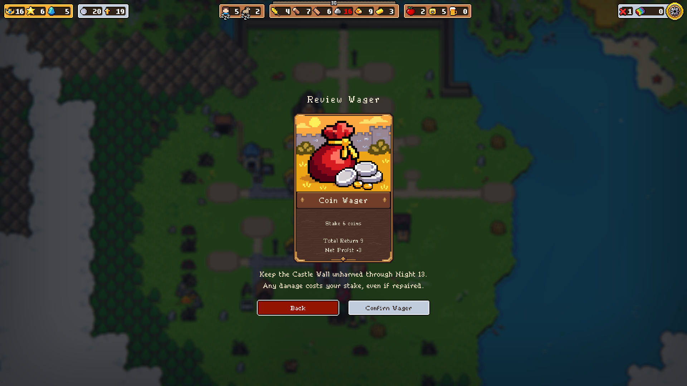
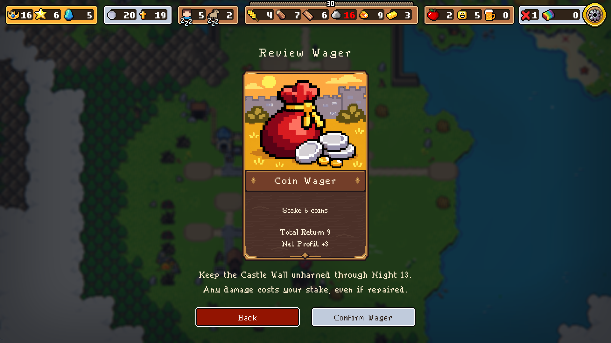
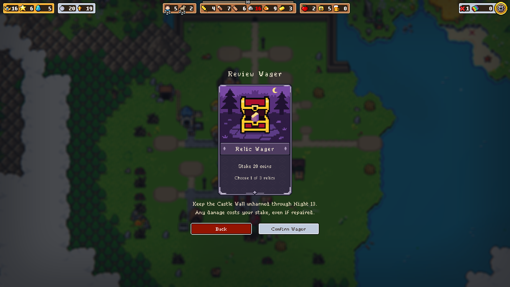
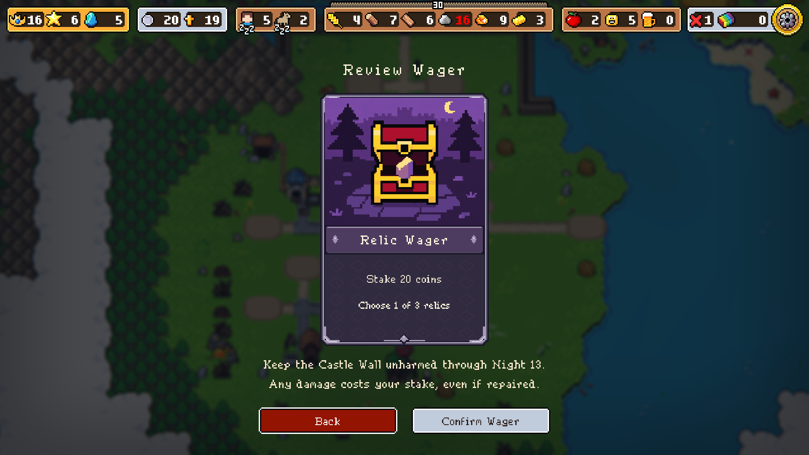
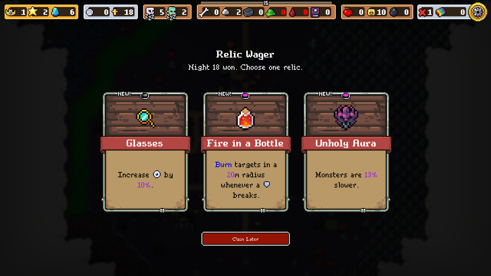
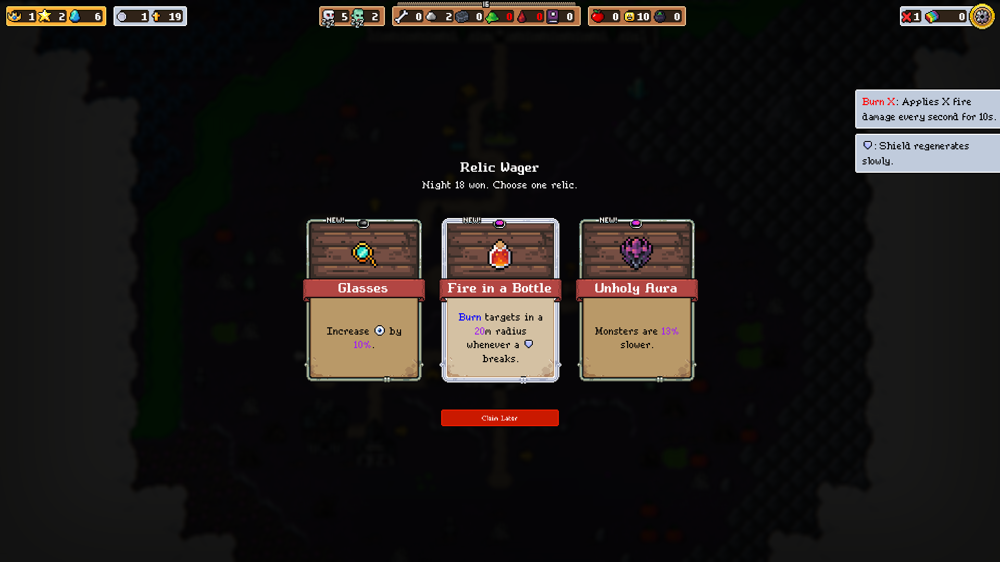
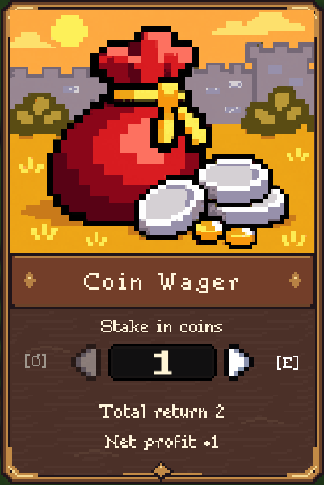
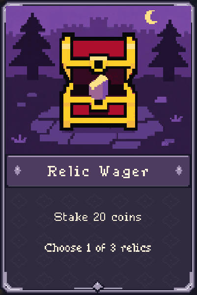

# Hold the Line

Before battle, choose a coin wager, stake 20 coins for a relic, or pass. To win, keep your Castle Wall unharmed through the entire night.

## Features

- One free decision each eligible night. **Pass** starts focused.
- Choose a target coin profit. The offer shows the stake, the total returned on a win, and the net profit before you commit.
- A **Relic Wager** costs exactly 20 coins. A win earns one of three distinct eligible ordinary relics. The offer needs three candidates before it can take your stake.
- Losing wall health forfeits either wager, even after a full repair. A fully shielded hit keeps the wager alive.
- The native checkpoint carries the accepted terms and any unclaimed rewards. Wagers accepted on 0.1.5 keep their original one-coin stake and three-coin return.

## How to Use

1. With a standing Castle Wall, wait for the prebattle offer. Use the arrows or the displayed controller shortcuts on the **Coin Wager** card to adjust the stake. The counter shows how many coins you will pay. For example, a profit of 3 costs 6 coins and returns 9 total on a win.
2. Choose **Coin Wager** or **Relic Wager** to review the terms. Select **Confirm Wager** to pay the displayed stake or **Back** to return to the cards. Choose **Pass** on the card screen to skip the wager for the night.
3. Defend the wall until the night ends. After a relic win, choose a card or select **Claim Later** to see those same choices on another morning or after Continue.

## Screenshots

### Wager Confirmation

### Relic Reward

### Wager Cards

| Coin Wager | Relic Wager |
| --- | --- |
| Adjust your stake and see the total return before committing. | Stake 20 coins for a chance to choose one of three relics. |
|  |  |

## Compatibility

- Tested on Super Fantasy Kingdom **0.8.070** with other [GKJ mods](https://thunderstore.io/c/super-fantasy-kingdom/p/GKJ/).
- With [Nights of Terror](https://thunderstore.io/c/super-fantasy-kingdom/p/GKJ/NightsOfTerror/), the wager stays active through the midnight reinforcements and settles with the rest of the night.
- With [Cursed Relics](https://thunderstore.io/c/super-fantasy-kingdom/p/GKJ/CursedRelics/), paid relic choices stay ordinary unless you enable `AllowPaidWager` in Cursed Relics. A change in the wall’s maximum health by itself leaves the wager intact.
- The offer can share the screen with [Daybook](https://thunderstore.io/c/super-fantasy-kingdom/p/GKJ/Daybook/) and [Visitor Calendar](https://thunderstore.io/c/super-fantasy-kingdom/p/GKJ/VisitorCalendar/). A wager requires a standing Castle Wall.
- These community mods can share the same profile. [Achievement Enabler](https://thunderstore.io/c/super-fantasy-kingdom/p/ownlyme/AchievementEnabler/), [Bakery Uses Wheat](https://thunderstore.io/c/super-fantasy-kingdom/p/ownlyme/BakeryUsesWheat/), [More Relics](https://thunderstore.io/c/super-fantasy-kingdom/p/ownlyme/MoreRelics/), [Right Click Skip](https://thunderstore.io/c/super-fantasy-kingdom/p/ownlyme/RightClickSkip/), and [Tavern Food Priorities](https://thunderstore.io/c/super-fantasy-kingdom/p/ownlyme/TavernFoodPriorities/).

## Installation

1. Open a Super Fantasy Kingdom profile in Thunderstore Mod Manager and install **HoldTheLine** by **GKJ**. Allow the manager to install [BepInExPack](https://thunderstore.io/c/super-fantasy-kingdom/p/BepInEx/BepInExPack/) and [HideManagerGameObject_Config](https://thunderstore.io/c/super-fantasy-kingdom/p/BepInEx/HideManagerGameObject_Config/).
2. Select **Start modded** and load your kingdom. Once you have a standing Castle Wall, watch for the offer before battle.

[Support GKJ Games on Ko-fi](https://ko-fi.com/gkj_games)
